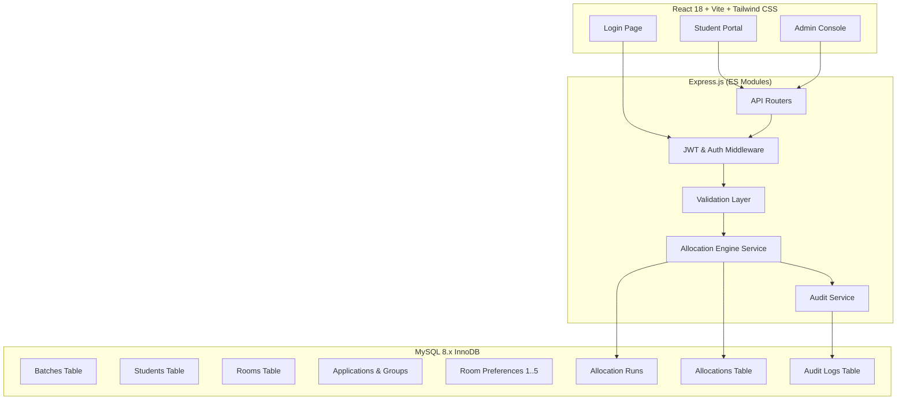

# HostelHub Architecture Documentation

## 1. System Overview
**HostelHub** is a production-grade, merit-based university hostel room allocation platform designed as an academic DBMS system. It provides an automated, deterministic, and transaction-safe allocation workflow for students applying either individually or as collaborative groups.

## 2. Monorepo Structure
- **`backend/`**: Express.js server, ES Modules, `mysql2/promise` connection pooling, JWT security, centralized error handling.
- **`frontend/`**: React 18 SPA with Tailwind CSS, React Router v6, Lucide icons, Axios HTTP client with Bearer token interceptor.
- **`database/`**: Relational DDL schema, migrations, and reproducible deterministic seed generator for 100 students, 80 rooms, and 200 beds.
- **`docs/`**: Academic DBMS architecture, normalization proofs, ER diagram, and viva defense guide.

## 3. Extensibility
The routing table explicitly reserves the mount point `/management` for a future Hostel Management Module (e.g. maintenance ticketing, mess billing, curfew log) without disrupting the Phase 1 allocation system.

