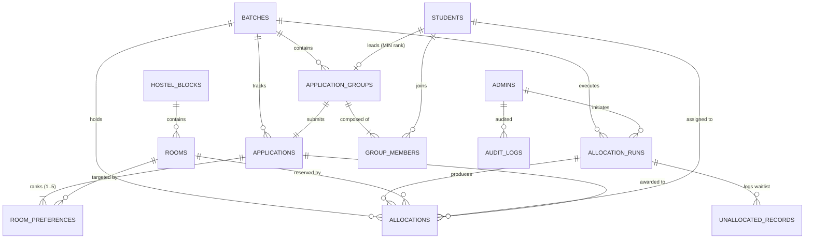

# HostelHub Database Design & Relational Model

## 1. Entity-Relationship (ER) Diagram



---

## 2. Relational Schema & Normalization (3NF)

Every relation in HostelHub is strictly normalized to **Third Normal Form (3NF)**:
1. **1NF (Atomic Attributes)**: Every column holds atomic, non-repeating values. Group members and 5 ranked preferences are modeled via normalized junction tables (`group_members`, `room_preferences`) rather than comma-separated lists or JSON arrays.
2. **2NF (Full Functional Dependency)**: All non-key attributes are fully functionally dependent on the entire primary key. In composite junction tables such as `room_preferences(application_id, preference_rank)`, attributes like `room_id` depend on the composite key.
3. **3NF (No Transitive Dependencies)**: Non-key attributes depend only on the primary key. For example, student details (name, email, branch) are not stored inside `allocations`; instead, `allocations` references `student_id`, avoiding update anomalies.

---

## 3. Strict Inventory Reconciliation Invariants
- **Hostel Blocks**: 3 physical blocks (`Block A`, `Block B`, `Block C`).
- **Exact Room Distribution**:
  - 20 Single Rooms (Capacity 1) = **20 beds**
  - 30 Double Rooms (Capacity 2) = **60 beds**
  - 30 Quadruple Rooms (Capacity 4) = **120 beds**
  - **Reconciliation Total**: $20 + 30 + 30 = \mathbf{80\text{ rooms}}$, $20 + 60 + 120 = \mathbf{200\text{ beds}}$.
- **Student Population**: Exactly 100 fictional students with unique merit ranks $1 \le \text{rank} \le 100$.

---

## 4. Key Constraints & Database Invariants

1. **`uk_student_per_batch` on `group_members (batch_id, student_id)`**:
   Ensures a student can belong to at most one application group per academic batch.
2. **`uk_app_pref_rank` on `room_preferences (application_id, preference_rank)`**:
   Enforces distinct preference positions 1, 2, 3, 4, 5 with no duplicate ranks.
3. **`uk_app_room` on `room_preferences (application_id, room_id)`**:
   Guarantees that an application cannot select the same room twice.
4. **`uk_block_room` on `rooms (block_id, room_number)`**:
   Enforces room number uniqueness within each hostel block.
5. **CHECK Constraints**:
   - `rooms.capacity IN (1, 2, 4)`
   - `application_groups.target_capacity IN (1, 2, 4)`
   - `room_preferences.preference_rank BETWEEN 1 AND 5`

---

## 5. SQL Dashboard Aggregations

All dashboard counts and metrics are dynamically computed from MySQL using relational joins and aggregates:

```sql
-- Compute Live Total Bed Capacity & Occupancy
SELECT 
    COUNT(DISTINCT r.id) AS total_rooms,
    SUM(r.capacity) AS total_beds,
    COUNT(DISTINCT al.room_id) AS occupied_rooms,
    COUNT(DISTINCT al.student_id) AS occupied_beds,
    ROUND((COUNT(DISTINCT al.room_id) / COUNT(DISTINCT r.id)) * 100, 1) AS room_occupancy_rate
FROM rooms r
LEFT JOIN allocations al ON r.id = al.room_id AND al.status = 'ACTIVE'
WHERE r.is_active = TRUE;
```

```sql
-- Distribution of Allocations by Preference Rank
SELECT 
    preference_rank_satisfied AS preference_rank,
    COUNT(DISTINCT application_id) AS awarded_groups,
    COUNT(student_id) AS total_students_housed
FROM allocations
WHERE status = 'ACTIVE'
GROUP BY preference_rank_satisfied
ORDER BY preference_rank_satisfied ASC;
```

---

## 6. Concurrency Control & ACID Transactions

The allocation engine executes within an atomic transaction at `ISOLATION LEVEL REPEATABLE READ`:
- **Row Locking**: Applications, rooms, and batches are acquired with `SELECT ... FOR UPDATE` to prevent race conditions during concurrent admin operations.
- **Controlled Vacancy**: When an admin marks an academic cycle vacated, the system executes:
  ```sql
  UPDATE allocations SET status = 'VACATED', vacated_at = NOW() WHERE batch_id = ?;
  ```
  This makes the 80 rooms immediately available for the next cycle without erasing historical audit records.

